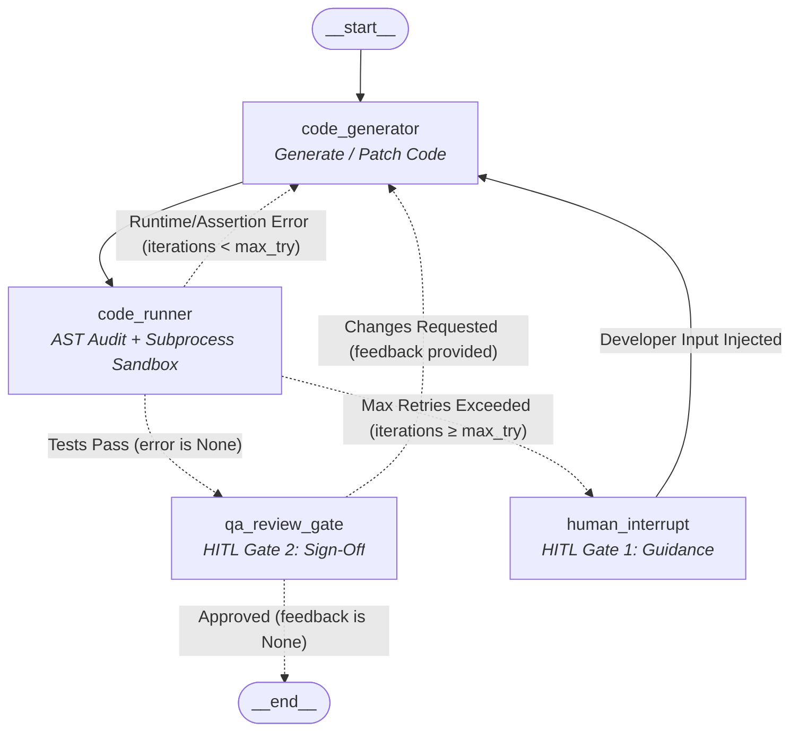

# Self-Healing Code Generation Agent (`pr-agent`)

[](https://www.python.org/downloads/)
[](https://github.com/langchain-ai/langgraph)
[](https://ai.google.dev/)
[](https://smith.langchain.com/)
[](LICENSE)

An autonomous, self-healing Python code generation and quality assurance agent orchestrated with **LangGraph** and powered by **Google Gemini**. The agent automatically generates executable Python solutions with self-contained unit tests (`assert` suites), runs them in a secure AST-audited subprocess sandbox, self-repairs runtime errors and test failures, and incorporates a dual-gate **Human-in-the-Loop (HITL)** architecture for escalation and final sign-off.

---

## Table of Contents

- [Key Features](#key-features)
- [Workflow Architecture](#workflow-architecture)
- [Project Structure](#project-structure)
- [Prerequisites](#prerequisites)
- [Installation & Setup](#installation--setup)
- [Running the Project](#running-the-project)
  - [1. LangGraph Studio & LangSmith UI (Recommended)](#1-langgraph-studio--langsmith-ui-recommended)
  - [2. Interactive CLI Mode (Alternative / Headless)](#2-interactive-cli-mode-alternative--headless)
  - [3. Testing the Security Sandbox](#3-testing-the-security-sandbox)
- [Security Sandbox Architecture](#security-sandbox-architecture)
- [State & Schema Design](#state--schema-design)
- [Configuration & Customization](#configuration--customization)
- [Observability & Tracing with LangSmith](#observability--tracing-with-langsmith)

---

## Key Features

- **Autonomous Self-Healing Loop**: The agent generates code with built-in validation assertions. If syntax or assertion errors occur, the compiler traceback is fed back to the LLM to self-heal up to a configurable retry limit (`max_try = 3`).
- **AST-Level & Subprocess Security Sandbox**:
  - **Static AST Inspection**: Pre-scans code trees using Python's `ast` module to ban risky imports (`socket`, `requests`, `subprocess`, `threading`, etc.) and dangerous calls (`os.system`, `popen`, `eval`, `exec`).
  - **Environment Sanitization**: Strips host environment variables to prevent API token or credential leaks from the execution environment.
  - **Ephemeral Filesystem**: Isolates execution inside a disposable `tempfile` sandbox directory.
  - **Process Timeout & Guardrails**: Enforces a 5-second execution timeout against infinite loops and truncates stdout/stderr to prevent token explosion.
- **Dual-Gate Human-in-the-Loop (HITL)**:
  - **Escalation Gate (`human_interrupt`)**: If the automated self-repair cycle exceeds 3 failed iterations, execution suspends. The human developer is prompted to supply guidance or debugging hints to unblock the agent.
  - **QA Verification Gate (`qa_review_gate`)**: Once all unit tests pass, execution suspends for human sign-off. The reviewer can approve the solution or reject it with specific refactoring/style requests.
- **Structured Schema Outputs**: Utilizes Pydantic structured output models (`code_base`) to guarantee algorithmic rationale and clean Python code separated from markdown wrappers.
- **LangSmith & Studio First Experience**: Optimized for visual orchestration, interactive HITL resumption, and deep observability through **LangGraph Studio** (`langgraph dev`) and **LangSmith**, with a terminal CLI (`main.py`) available as a lightweight fallback.

---

## Workflow Architecture



---

## Project Structure

```
pr_agent/
│
├── .env.example               # Template for Gemini and LangSmith API credentials
├── .gitignore                 # Standard Python/IDE ignore rules
├── langgraph.json             # LangGraph Studio/CLI graph deployment manifest
├── pyproject.toml             # Project metadata, tools, and dependencies (PEP 621)
├── README.md                  # Comprehensive project documentation
├── requirements.txt           # Pinned dependencies for standard virtualenv/pip
├── uv.lock                    # Deterministic lockfile for uv package manager
│
└── src/
    ├── __init__.py            # (Optional package root)
    ├── executor.py            # AST security scanner & sandboxed subprocess executor
    ├── graph.py               # LangGraph StateGraph definitions, nodes, and conditional edges
    ├── main.py                # Interactive CLI runner handling interrupts & state resume
    ├── nodes.py               # Graph node implementations (LLM prompts, runner, HITL gates)
    ├── schema.py              # Pydantic schemas (code_base) for structured LLM generation
    └── state.py               # TypedDict defining AgentState throughout the pipeline
```

---

## Prerequisites

- **Python 3.12+**
- **Google Gemini API Key**: Powers the code generation and self-repair model ([Google AI Studio](https://aistudio.google.com/)).
- **LangSmith API Key (Strongly Recommended)**: Provides full telemetry, visual execution tracing, token latency auditing, and enables the interactive **LangGraph Studio** interface ([LangSmith Sign Up](https://smith.langchain.com/)).

---

## Installation & Setup

### 1. Clone the Repository

```bash
git clone https://github.com/your-username/pr_agent.git
cd pr_agent
```

### 2. Environment Configuration

Copy `.env.example` to `.env` and fill in your API credentials:

```bash
cp .env.example .env
```

Edit `.env`:

```dotenv
# LLM Provider
GOOGLE_API_KEY=your_gemini_api_key_here

# Telemetry & Observability (Optional)
LANGSMITH_TRACING=true
LANGSMITH_ENDPOINT="https://api.smith.langchain.com"
LANGSMITH_PROJECT=pr_agent
LANGSMITH_API_KEY=your_langsmith_api_key_here
```

### 3. Install Dependencies

You can use either **`uv`** (recommended for high-speed setup) or standard **`pip`**:

#### Option A: Using `uv` (Recommended)
```bash
# Create virtual environment and synchronize dependencies
uv venv
uv sync
```

#### Option B: Using standard Python `venv` + `pip`
```bash
# Create and activate virtual environment
python -m venv .venv

# Windows (Command Prompt / PowerShell):
.venv\Scripts\activate

# Linux / macOS:
source .venv/bin/activate

# Install dependencies
pip install -r requirements.txt
```

---

## Running the Project

> [!TIP]
> ### 🌟 Strongly Recommended: Use LangSmith & LangGraph Studio
> For the best developer experience, **LangGraph Studio** (`langgraph dev`) coupled with **LangSmith** is the strongly recommended way to interact with and observe this agent.
> 
> Compared to the terminal CLI, LangGraph Studio and LangSmith offer:
> - **Visual Interactive Canvas**: Watch the state flow in real time from `__start__` through `code_generator`, `code_runner`, and conditional branches.
> - **Intuitive HITL Gate Controls**: Seamlessly approve or reject code in `qa_review_gate`, or type guidance in `human_interrupt` directly through structured UI form fields without terminal truncation.
> - **Time-Travel & State Stepping**: Replay any past execution node, modify state variables in-place, and re-run branches without restarting the process.
> - **Deep Tracing & Telemetry**: Automatically record full prompt payloads, Gemini response tokens, execution latencies, and sandbox tracebacks inside your LangSmith dashboard.

---

### 1. LangGraph Studio & LangSmith UI (Recommended)

The project includes [`langgraph.json`](langgraph.json) pre-configured to launch the local LangGraph Studio web interface.

#### Step 1: Ensure LangSmith Tracing is Enabled
In your `.env` file, ensure your LangSmith credentials are configured:
```dotenv
LANGSMITH_TRACING=true
LANGSMITH_ENDPOINT="https://api.smith.langchain.com"
LANGSMITH_PROJECT=pr_agent
LANGSMITH_API_KEY=your_langsmith_api_key_here
```

#### Step 2: Start the Development Server
```bash
langgraph dev
```

#### Step 3: Interact in the Studio Web UI
1. Open the local Studio URL printed in your terminal (typically `http://localhost:2024` or the LangGraph Cloud Studio link).
2. Select the `agent` graph.
3. In the **Input** tab, supply the initial task JSON:
   ```json
   {
     "task": "Write a Python function to find the longest palindromic substring with O(n^2) complexity."
   }
   ```
4. Click **Submit** or **Run**.
5. **Handling Interrupts in the UI**:
   - **When reaching `qa_review_gate`**: Execution will pause. The candidate code and test results will be displayed. You can resume with:
     ```json
     {
       "approved": true
     }
     ```
     *(Or provide review notes: `{"approved": false, "notes": "Add docstrings and type hints."}` to trigger automated refactoring)*.
   - **When reaching `human_interrupt`**: If self-healing exceeds 3 attempts, execution halts and presents the error. Provide debugging advice:
     ```json
     {
       "feedback": "Use a two-pointer approach expanding around the center."
     }
     ```
6. **Inspect in LangSmith**: Click the run trace link in Studio or visit your [LangSmith Projects](https://smith.langchain.com/) to view comprehensive latency, LLM cost, and execution trees for every step.

---

### 2. Interactive CLI Mode (Alternative / Headless)

If you prefer terminal-only execution or need a headless workflow, you can run the interactive CLI:

```bash
python src/main.py
```

#### Interaction Flow:
1. **Enter Problem**: Type your problem description at the prompt.
2. **Automated Generation & Testing**: The agent writes the implementation and assertions, executing them in the sandbox.
3. **HITL Review**:
   - If tests pass immediately, you are prompted at the **QA Verification Gate**:
     ```text
     ======================================================================
     [?] QA VERIFICATION GATE: All Sandboxed Assertions Passed
     ======================================================================
     Candidate Implementation for Review:
     ----------------------------------------------------------------------
     def longest_palindrome(s: str) -> str:
         ...
     assert longest_palindrome("babad") in ["bab", "aba"]
     ----------------------------------------------------------------------

     Approve candidate code for final delivery? (y/n):
     ```
   - Enter `y` to approve and complete the run.
   - Enter `n` to provide specific modification requests; the agent will revise the code and re-test.
4. **HITL Escalation**:
   - If automated repairs reach the threshold of 3 consecutive failures, the terminal will prompt:
     ```text
     !!!!!!!!!!!!!!!!!!!!!!!!!!!!!!!!!!!!!!!!!!!!!!!!!!!!!!!!!!!!!!!!!!!!!!
     [!] HITL ESCALATION GATE: Automated Repair Threshold Exceeded
     !!!!!!!!!!!!!!!!!!!!!!!!!!!!!!!!!!!!!!!!!!!!!!!!!!!!!!!!!!!!!!!!!!!!!!
     Total Iterations Attempted : 3
     Captured Traceback / Stderr:
     AssertionError: ...

     Enter directional guidance or debugging hint for the agent:
     ```

---

### 3. Testing the Security Sandbox

You can verify the sandbox's AST audit rules and subprocess limits independently:

```bash
python src/executor.py
```

Expected output:
```text
1. Testing valid code:
Result: success=True, err=None

2. Testing failing assert:
Result: success=False, err=Traceback (most recent call last):
  ...
AssertionError

3. Testing banned import:
Result: success=False, err=Security Violation: Import of 'socket' is prohibited.

4. Testing os.system attempt:
Result: success=False, err=Security Violation: Call to 'system()' is prohibited.
```

---

## Security Sandbox Architecture

Executing LLM-generated code requires strict defensive controls. `src/executor.py` implements a multi-layer isolation pattern:

| Layer | Mechanism | Protection |
| :--- | :--- | :--- |
| **AST Pre-Check** | Static syntax tree inspection | Blocks blacklisted imports (`socket`, `urllib`, `requests`, `http`, `subprocess`, `shutil`, `pty`, `multiprocessing`, `threading`) and calls (`os.system`, `popen`, `exec`, `eval`). |
| **Env Sanitization** | `clean_env` mapping | Strips system environment variables (e.g., `GOOGLE_API_KEY`, `LANGSMITH_API_KEY`) so code cannot read process secrets. Sets empty `PYTHONPATH` to prevent local project code tampering. |
| **Filesystem Jail** | `tempfile.TemporaryDirectory` | Code is written and executed inside an ephemeral directory that is completely deleted upon exit. |
| **Execution Timeout** | `subprocess.run(timeout=5)` | Prevents hanging threads, deadlocks, and infinite loops. |
| **Output Truncation** | 2,000-character cap | Caps verbose tracebacks or output logs to avoid overwhelming LLM token budgets. |

---

## State & Schema Design

### 1. `AgentState` (`src/state.py`)
Tracks execution data and loop progression across graph transitions:

```python
class AgentState(TypedDict):
    task: str                          # Original user prompt/problem statement
    code: NotRequired[Optional[str]]    # Latest candidate Python script
    error: NotRequired[Optional[str]]   # Stderr/Traceback from failed test execution
    iterations: NotRequired[int]       # Number of consecutive repair attempts
    feedback: NotRequired[Optional[str]] # Human guidance or reviewer critique
```

### 2. Structured LLM Output (`src/schema.py`)
Ensures the Gemini model adheres to structured output guarantees:

```python
class code_base(BaseModel):
    explaination: str = Field(
        description="A concise rationale explaining the algorithmic approach and logic."
    )
    code: str = Field(
        description="Executable, self-contained Python code including assert statements for tests."
    )
```

---

## Configuration & Customization

- **Change LLM Model**: In [`src/nodes.py`](src/nodes.py), modify the model parameters:
  ```python
  model = init_chat_model(
      "gemini-2.5-pro",  # Or "gemini-3.5-flash-lite", "gemini-2.5-flash"
      model_provider="google_genai",
      temperature=0.1
  )
  ```
- **Change Max Retries**: In [`src/graph.py`](src/graph.py), adjust `max_try`:
  ```python
  max_try = 5  # Adjust retry tolerance before escalating to human
  ```
- **Change Sandbox Timeout**: In [`src/executor.py`](src/executor.py), customize `timeout_seconds`:
  ```python
  def execute_pycode(code: str, timeout_seconds: int = 10) -> Tuple[bool, Optional[str]]:
  ```

---

## Observability & Tracing with LangSmith

When `LANGSMITH_TRACING=true` is enabled in your `.env`, every graph execution, node transition, structured LLM prompt, and interrupt state is automatically cataloged in your [LangSmith Dashboard](https://smith.langchain.com/):

- **Full Execution Trees**: Step through the complete run hierarchy across `code_generator`, `code_runner`, and HITL checkpoints.
- **Payload & State Inspection**: Inspect raw structured inputs, system prompts, Gemini outputs, and sandbox stderr tracebacks in high fidelity without terminal character truncation.
- **Latency & Token Cost Telemetry**: Track token usage, prompt token distribution, latency per node, and API invocation overhead.
- **Debugging & Time-Travel Evaluation**: Pinpoint exact iterations where errors were introduced and analyze how the agent self-healed in subsequent attempts.

---

## License

This project is licensed under the [MIT License](LICENSE).

